# tde-firewalld

A firewall manager for the [Trinity Desktop Environment](https://www.trinitydesktop.org/)
(TDE) that configures [firewalld](https://firewalld.org/).

It comes in two forms that share the same user interface:

* a **Trinity Control Center module**: *Security & Privacy → Firewall*, or
  `tdecmshell firewalld`
* a **standalone application**: `tde-firewalld`

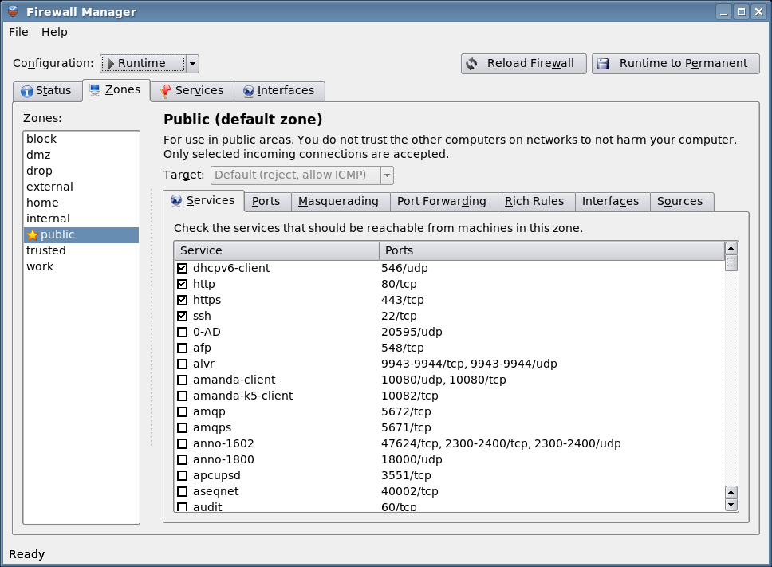

## Features

* Shows whether firewalld is running, its version and the active zones
* Default zone, panic mode and logging of denied packets
* Per zone: allowed services, open ports and port ranges, masquerading,
  port forwarding, rich rules, bound interfaces and source addresses, and
  the zone target
* A read-only browser for service definitions
* An interface → zone overview, with a "Change Zone" action
* Edits either the **runtime** or the **permanent** configuration, with
  *Reload Firewall* and *Runtime to Permanent* buttons
* Updates live when the configuration is changed elsewhere (for example
  with `firewall-cmd`), using firewalld's D-Bus signals
* A KHelpCenter handbook and a man page

## How it works

tde-firewalld talks to firewalld directly over the D-Bus system bus
(`org.fedoraproject.FirewallD1`) using the TQt D-Bus bindings
(`dbus-1-tqt`). It does not run `firewall-cmd`, and it never runs as root.

firewalld checks every request with **polkit**
(`org.fedoraproject.FirewallD1.info`, `.config.info`, `.config` and `.all`)
and allows interactive authentication. When a password is needed, the
session's polkit agent (**polkit-agent-tde**) asks for it. Calls that change
the firewall are asynchronous, so the window stays responsive while the
password dialog is open. If authentication is cancelled, the application
stops asking and shows an *Authenticate...* button instead of prompting for
every remaining request.

| Status | Authentication cancelled |
|---|---|
| 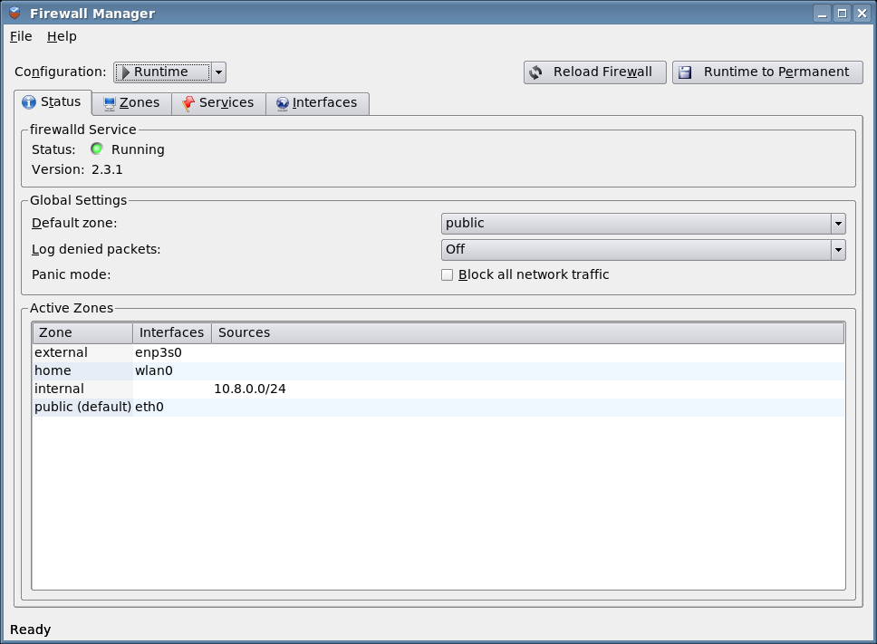 | 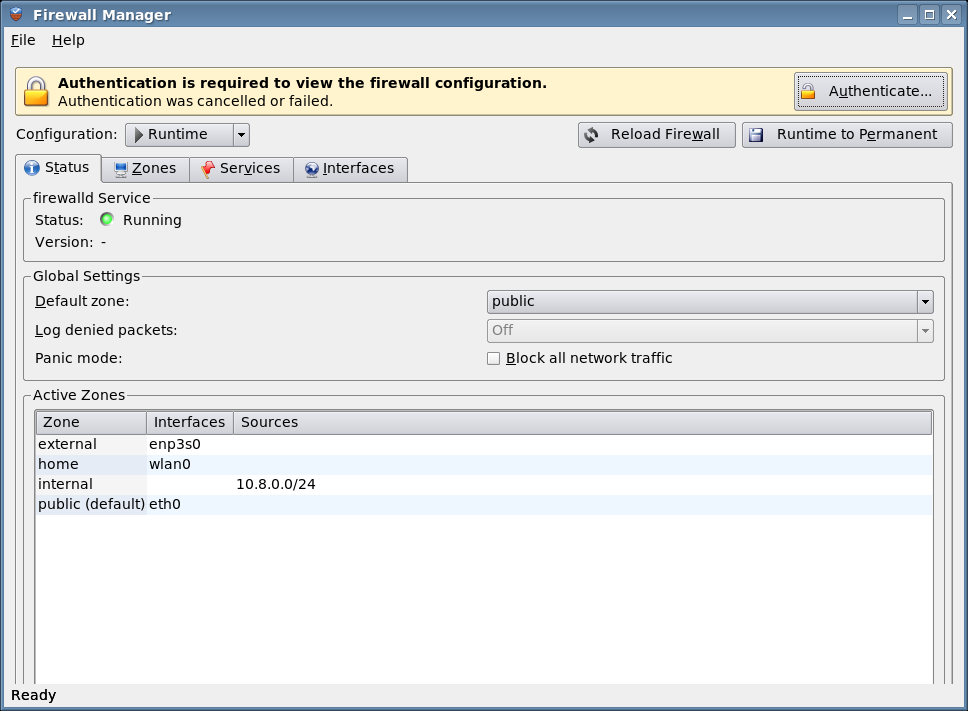 |

## Installing

Pre-built packages for **Debian 12 (bookworm)** and **Debian 13 (trixie)**
are built by GitHub Actions. Download them from the
[Releases](https://github.com/Yjlion/tde-firewalld/releases) page or from the
artifacts of the latest *Build Debian packages* workflow run, then:

```sh
sudo apt install ./tde-firewalld-trinity_*.deb
sudo systemctl enable --now firewalld
```

The package depends on `firewalld` and `polkit-agent-tde` from the
[TDE repository](https://wiki.trinitydesktop.org/Debian_Trinity_Repository_Installation_Instructions).

## Building from source

Build dependencies (Debian names, from the TDE repository):
`cmake tde-cmake tdelibs14-trinity-dev libtqt3-mt-dev libtqtinterface-dev libdbus-1-tqt-dev libdbus-1-dev pkgconf`

```sh
mkdir build && cd build
cmake .. -DCMAKE_INSTALL_PREFIX=/opt/trinity
make
sudo make install
```

To build the Debian package:

```sh
sudo apt build-dep ./      # or: mk-build-deps --install debian/control
dpkg-buildpackage -us -uc -b
```

## Documentation

* Handbook: open *Help → Firewall Manager Handbook*, or `help:/tde-firewalld`
  in KHelpCenter (source: [`doc/en/index.docbook`](doc/en/index.docbook))
* Manual page: `man tde-firewalld` (source: [`doc/man/tde-firewalld.1`](doc/man/tde-firewalld.1))

## Screenshots

| | |
|---|---|
| 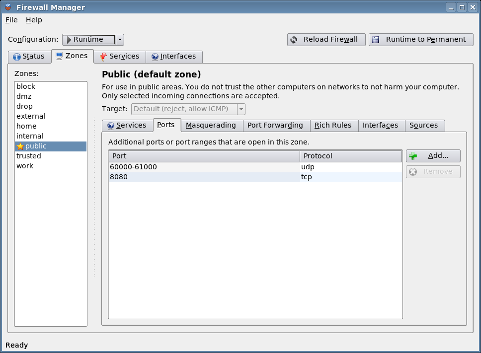 | 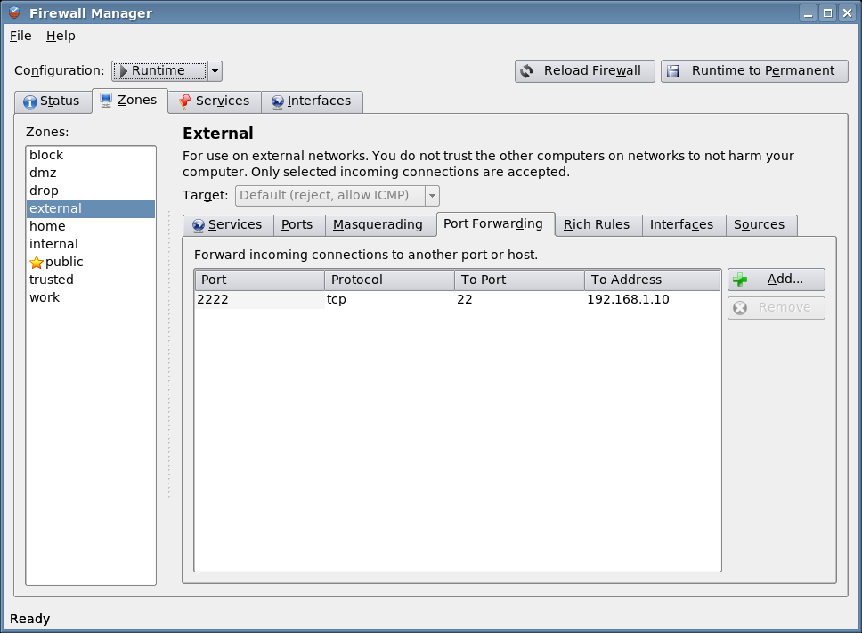 |
| 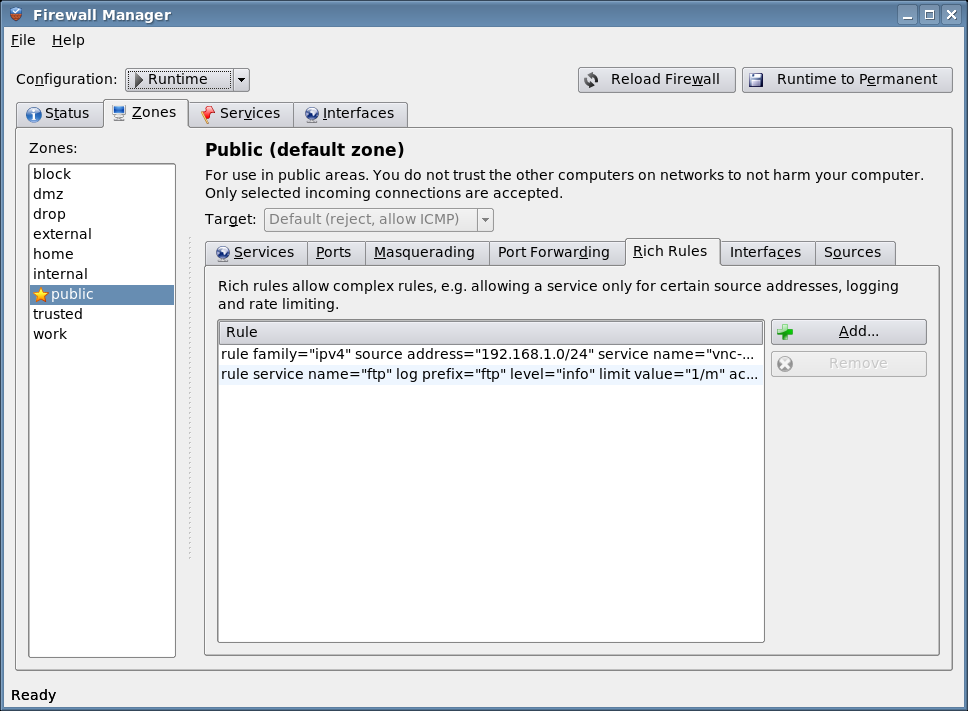 | 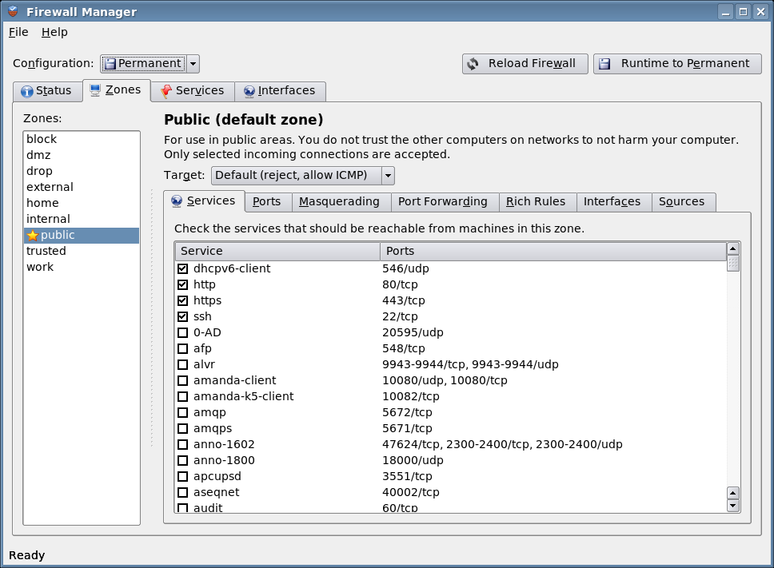 |
| 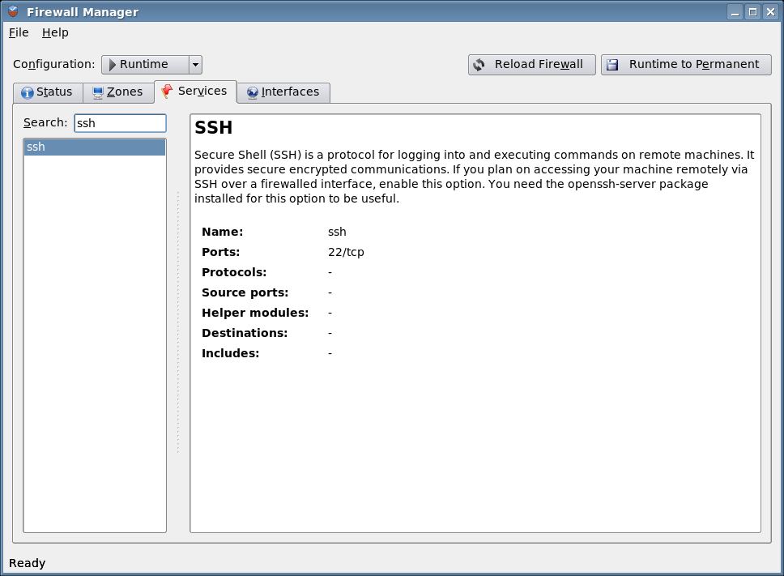 | 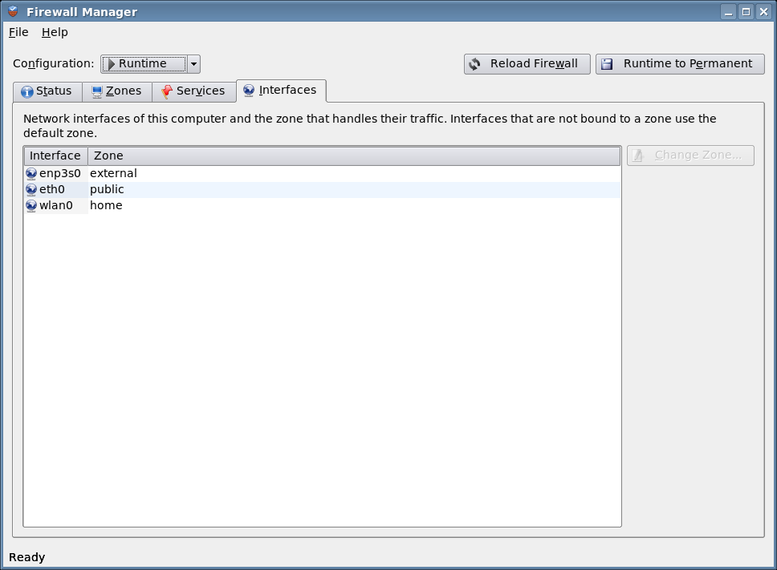 |
| 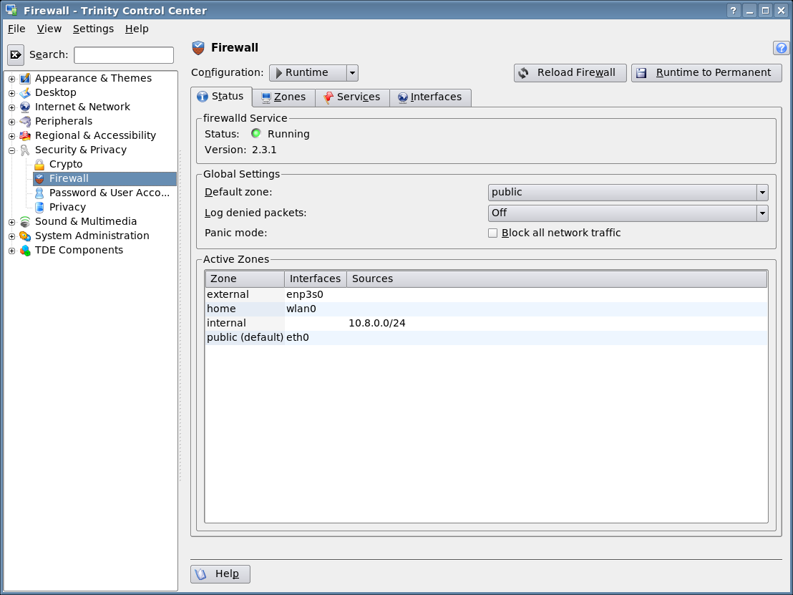 | 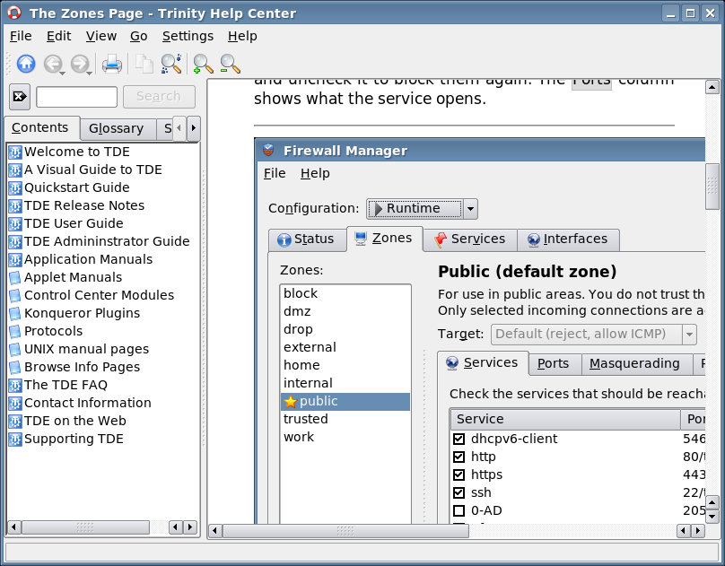 |
| 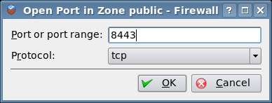 | 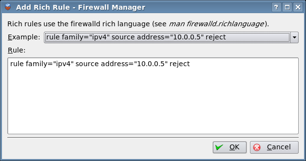 |

The screenshots were taken with `tools/take-screenshots.sh` against a real
firewalld 2.3 in a Debian trixie container.

## License

GPL-2.0-or-later, see [COPYING](COPYING). The handbook may also be used under
the GNU Free Documentation License 1.2 or later.
